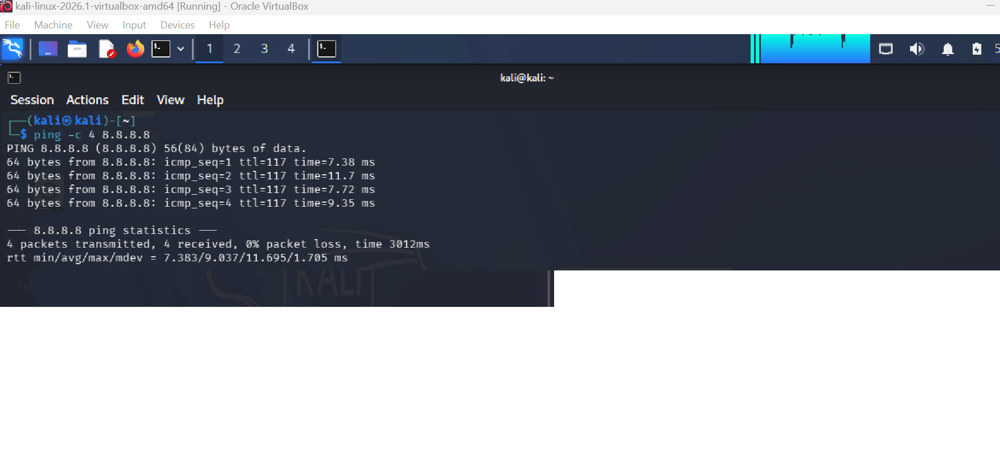
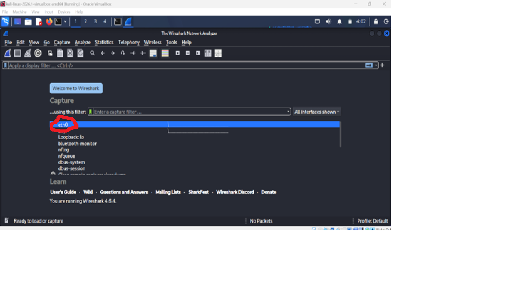
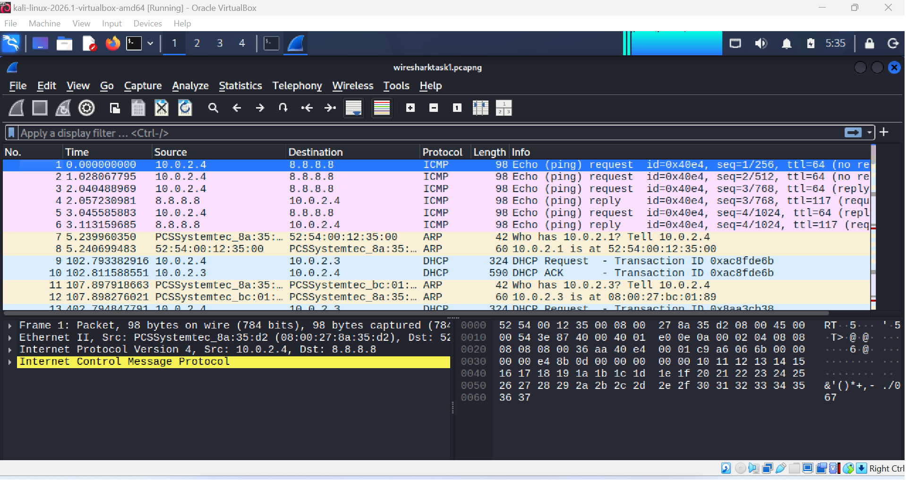
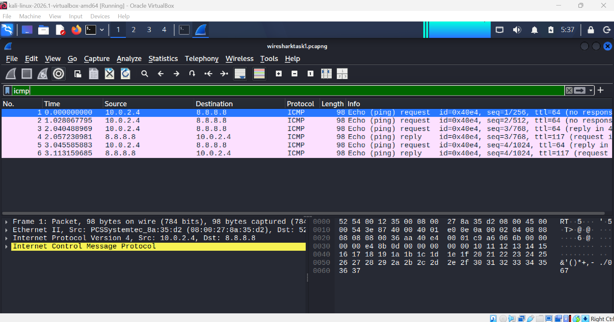

# Wireshark Network Analysis
Hands-on network traffic analysis using Wireshark, including packet capture, ICMP filtering and protocol inspection.

Open terminal and ping -c 4 8.8.8.8

Open wireshark and activate eth0

Capturing Started

Type icmp in the filter bar and then enter

## Identified Packet 1 & 4

Packet 1 – ICMP Echo Request

| **Field** | **Information** |
|---|---|
| Source IP | `10.0.2.4` |
| Destination IP | `8.8.8.8` |
| Protocol | ICMP |
| Packet Length | 98 bytes |
| Info | Echo (ping) request |

Packet 4 – ICMP Echo Reply

| **Field** | **Information** |
|---|---|
| Source IP | `8.8.8.8` |
| Destination IP | `10.0.2.4` |
| Protocol | ICMP |
| Packet Length | 98 bytes |
| Info | Echo (ping) reply |

## Observation

I observed the ICMP traffic between my Kali Linux virtual machine and the IP address 8.8.8.8.

The ICMP Echo Request packets were sent from my Kali virtual machine (10.0.2.4) to 8.8.8.8. The destination responded with ICMP Echo Reply packets, which were sent back to my Kali virtual machine.

Each of the ICMP packet had a length of 98 bytes. This showed that there were request and reply packets, demonstrating how ICMP is used to test network connectivity between two devices.

The icmp I used in the filter helped me isolate ICMP packets from other network traffic for easier analysis.
